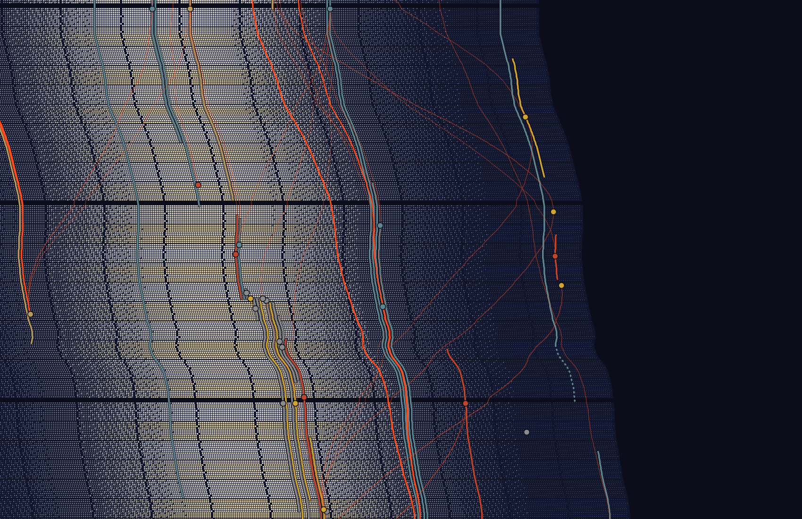

# A Fabric Through Time

You just got big dave'd 

An open, experimental art and code project. It starts in Bradford-on-Avon and asks:

> What happens when the tools of the present interpret the traces left by the tools of the past?

The idea is to use a contemporary machine's learned associations to weave together records of the tools, materials and lives that shaped a place (the river, early settlement, woollen cloth, rubber) and to let those relationships decide the form of original generative artworks. The hope is a piece that can be shown locally, made with AI as a tool, that gets away from the sense that all AI does is copy and steal.

It may well go nowhere. Everything is kept in the open either way: sources, prompts, model judgements, code and the dead ends.



## What's here

| | |
|---|---|
| [`thesis/project-thesis.md`](thesis/project-thesis.md) | The working thesis: what the project claims, and the tests it sets itself. |
| [`INSPIRATIONS.md`](INSPIRATIONS.md) | Anna Lucia, Patrik Hübner, Matt DesLauriers, Zach Lieberman and Giorgia Lupi, and what the project takes from each. |
| [`data/records.json`](data/records.json) | The corpus so far: 46 sourced, fact-checked records. All are modern paraphrases, none in original wording yet. |
| [`data/described-spans.json`](data/described-spans.json), [`data/river/`](data/river/) | The span of years each record describes (Claude's rough reading), and the River Avon's course from OpenStreetMap. |
| [`experiments/01-kingston-test/`](experiments/01-kingston-test/) | The first experiment, made before this repository existed: do two models, reading the records blind, find links that keyword matching and a random shuffle don't? Provisionally yes, with heavy caveats. See its [write-up](experiments/01-kingston-test/WRITEUP.md). |
| [`studies/`](studies/) | Generative sketches that turn those links into form. Five so far: [Gather, Meander, Hold, Days and Threads](studies/README.md). Plus five [seeded studies](studies/seeds/README.md), each made by a separate agent from a random string. |
| [`transcripts/`](transcripts/) | The conversations with AI models that shaped the project, as exported. |

## Three rules from the thesis

1. **The removal test.** If the AI-derived relationships were taken out, would the artwork lose part of its structure or meaning, or would it only have taken longer to make?
2. **The shuffled control.** If a work looks the same when its relationships are reassigned at random, the mapping is too weak.
3. **Documented and interpretive stay distinct.** A link a model proposes is an interpretation. It is never dressed up as historical fact.

## Running things

```
npm run render     # draw every study under every reading into studies/out/
npm run serve      # then open http://localhost:4173/studies/
```

The studies need Node 20 or later and nothing else. Experiment 01's analysis scripts need Python with `requirements.txt`; see [its README](experiments/01-kingston-test/README.md).

## Who made what

The project, its question and its thesis are James Ward's. Experiment 01, the corpus paraphrases, the study code and most of the prose in this repository were written by Claude (Anthropic's Opus 5.5) working with James, and are marked as such where it matters. Model-generated judgements are kept as generated text and labelled.

## Licence and sources

Code is under the [MIT licence](LICENSE). The artworks, images and writing are not yet under an open licence; that is still to be decided.

The river course in `data/river/` is from OpenStreetMap, © OpenStreetMap contributors, under the Open Database Licence.

The records in `data/` are paraphrases of copyrighted modern sources, each linked to its page. They are here for research. Check each source's terms before reusing them, and never present them as quotations.
