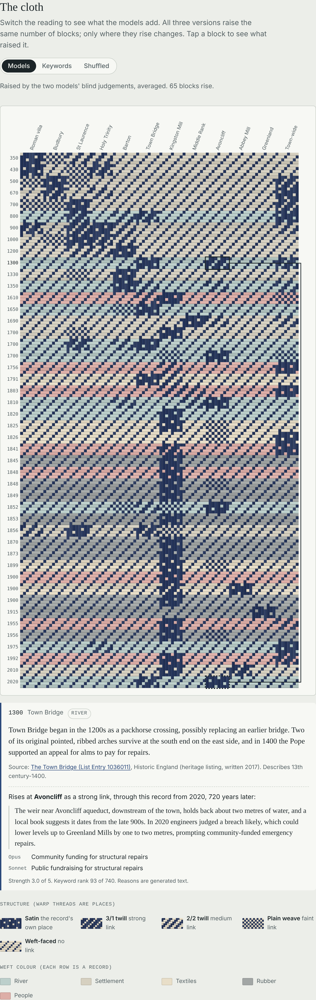

# Experiment 01 write-up: the first session

> Moved here from the root README of the pre-repository zip when the git repo was set up (13 October 2026). Only this note, the image path and the file listing below were changed; paths in the listing are relative to the repo root.

Working repository for an exploratory generative art project that begins with Bradford-on-Avon: its river, early settlement and Saxon history, woollen cloth and rubber. The core idea, from the thesis, is to use a contemporary machine's learned associations to weave together records of the tools, materials and lives that shaped a place.

This first commit holds:

- the thesis
- a starter corpus of 46 sourced records
- one complete experiment, the Kingston Mills test cloth

This README covers what I did, what went wrong, what the test showed, and what I think should happen next.

*Written by Claude (Opus 5.5) on 13 October 2026, at the end of the session that produced everything here.*



---

## Contents

```
experiments/01-kingston-test/WRITEUP.md   this file (originally the root README)
requirements.txt               numpy, scikit-learn
thesis/
  project-thesis.md            the working thesis and outline (was project-thesis.txt; same text, with markdown formatting)
data/
  records.json                 the living corpus: 46 records, fact-checked and corrected
experiments/01-kingston-test/
  README.md                    how to rerun this experiment
  prompts/                     every prompt sent to a model, word for word
  research/                    raw output of the two research agents, untouched
  inputs/
    records_as_judged.json     the records exactly as the models read them (before fixes)
    blind_corpus.txt           the shuffled, coded text the models were given
    codes.json                 record id -> blind code
  judgements/
    opus.json, sonnet.json     the two models' blind link lists, as returned
  fact_check/results.json      per-record verdicts from the fact-check
  scripts/                     01 to 07, run in order (see the experiment README)
  outputs/                     everything the scripts generate, including analysis.txt
  page/
    template.html              the page source without data
    kingston-test-cloth.html   the finished page, self-contained; open it in a browser
    preview.png                image of the cloth section
```

## Where things stand

- **The test answered its main question, provisionally.** The models contributed links that plain keyword matching doesn't find. Removing them changes about half of the cloth's structure.
- **The links they contributed are interpretive affinities, not documented connections,** and some of them may come from the sources' language rather than from the town.
- **The corpus is the weak point.** All 46 records are paraphrases written by Claude from modern sources, and nothing is yet in its original wording.
- **The visual grammar works as notation** but is still a diagnostic, not an artwork.

---

## 1. The thesis, and my first read

Before the test, I read the thesis and gave this assessment.

**What's strong.** Three safeguards are exactly what stops this kind of project becoming decoration with a method statement attached:

- the removal test
- the shuffled-relationship control
- the line between documented relationships and interpretive affinities

Kingston Mills is a good first site, because the same riverside ground went from cloth to rubber.

**My concerns:**

- **It was all scaffolding.** Nearly every section guarded against a failure, and almost none proposed what the work looks like. The visual language was the thinnest part.
- **Embeddings mostly find style, not meaning.** Used off the shelf, a Victorian newspaper sits near other Victorian prose, and a heritage leaflet sits near other leaflets, whatever they describe.
- **The original idea had slipped away.** The project started from how the town exists inside a model. One way back would be to ask a model about Bradford-on-Avon with no sources, and treat the gap between its account and the archive as a separate, clearly marked layer.

**What I suggested:**

1. Start with a bounded sample of 50 to 100 records about Kingston Mills.
2. Write down your expected connections before involving any model.
3. Keep only links that cross both period and source type.
4. Build the visual grammar in parallel using random data, so the shuffled control exists from day one.
5. Consider a weave draft as notation, even if nothing ends up woven. A draft is a grid of over/under decisions, so a similarity matrix can drive it directly.

The Jacquard loom's punched cards fed into the early history of computing. That makes a model reading the textile records, loosely, a descendant of those tools reading their traces.

---

## 2. Experiment 01: Kingston Mills test cloth

### What I set out to do

Gather records, compare them with a sentence-embedding model under a cross-period, cross-source filter, compare that with a keyword baseline and a shuffled control, and turn the result into a first weave-draft study.

### What actually happened, in order

1. **Research (about an hour).** I launched three research agents with web search:
   - **Kingston Mill, textiles and rubber.** Returned 24 records.
   - **River, crossings and Saxon history.** Returned 22 records.
   - **Older public-domain texts** (Leland, Aubrey, Defoe, Canon Jones, Domesday, gazetteers). This one was cancelled when you interrupted to check on me, before it ran.

   As a result the corpus has no records in their original wording. The research also took over an hour without a progress update from me, which was too long. Prompts are in `prompts/`, and the two finished agents' output is in `research/`, untouched.

2. **Transcription.** I copied the agents' records into `inputs/records_as_judged.json` and added three things to each:
   - an `id` (K01 to K24, R01 to R22)
   - a single focal `year` that I chose
   - a `site_group`

   I also shortened some of the agents' uncertainty notes. The full notes are in `research/`.

3. **No embedding model.** The plan was a sentence-embedding model. This workspace's network policy blocked Hugging Face and then PyPI (403 from the egress proxy), and no embedding model was installed locally, so I couldn't run embeddings at all.

4. **The substitute: blind judging.** I shuffled the records and gave them neutral codes. Two separate agents, Claude Opus 5.5 and Claude Sonnet 5.5, each read the coded text with no project context. Each named up to four related passages per record, with a strength from 1 to 5 and a reason of eight words or fewer.

   They were told not to count resemblance that rests only on the same place, person, organisation or period. The prompt is in `prompts/blind_judge.md`.

5. **Keyword baseline.** I used TF-IDF cosine similarity with common English words removed, on the same text the models read.

6. **The century rule.** A link counts only between records at least 100 years apart that come from different web pages. That leaves 740 of the 1,035 possible pairs.

7. **Fact-check.** Three separate Sonnet agents checked every record against its source page:
   - 39 were fine.
   - 7 had small slips (for example "sales" where the source says "output", or "saw" where it says "reported").
   - None was wrong or unreachable.

   The fixes are in `data/records.json`. The models had already read the earlier wording, and the fixes change wording, not substance.

8. **The cloth.** Each of twelve places is a block of eight warp threads, and each record is four picks of weft, coloured by its strand, oldest at the top. The structure of each block is set like this:

   | Block | Structure |
   |---|---|
   | The record's own place | Satin, so it reads as solid warp (documented) |
   | Strongest link to that place is 3 or more | 3/1 twill |
   | Strongest link is 2 to 2.5 | 2/2 twill |
   | Any weaker link | Plain weave |
   | No link | Weft-faced twill |

   The keyword and shuffled versions raise the same number of blocks at each level, ranked by their own scores, so only placement differs.

9. **The page.** I published it as a private claude.ai artifact (https://claude.ai/artifact/GfFCjFBXSMPsZqfXS5HSWf, which only you can open unless you share it). A self-contained copy is in `page/`.

### Results

All figures are reproduced by the scripts and logged in `outputs/`.

| Measure | Value |
|---|---|
| Records / web pages / publishers | 46 / 34 / about 20 |
| Pairs possible / passing the century rule | 1,035 / 740 |
| Pairs linked by Opus / Sonnet / both | 102 / 86 / 73 (Jaccard 0.63) |
| Strong links (≥3) by Opus / Sonnet / both | 63 / 58 / 46 |
| Cross-century links, either model / both | 50 / 29 |
| …also in the keyword method's top 50 | 22 (chance would give about 3.4) |
| …found only by the models | 28 |
| …between records at the same place / different places | 11 / 39 |
| Cloth: raised blocks (faint / medium / strong) | 65 (21 / 26 / 18), plus 46 own-place blocks |
| Keyword cloth: raised blocks shared with the models' cloth | 31 of 65 |
| Shuffled cloth: raised blocks shared, over 200 draws | 11.7 on average, 20 at most |

### Links worth looking at

These links were found by the models but ranked low by keywords. The keyword rank is out of 740.

| Records | Years | What links them (the models' reasons) | Keyword rank |
|---|---|---|---|
| R04 bridge chapel became a lock-up · R09 Saxon church became a cottage and school | 1700 · 1856 | A sacred building turned to secular use | 683 |
| R02 the Pope backs alms for Town Bridge repairs · R18 community-funded Avoncliff weir repairs | 1300 · 2020 | Repairs paid for by public appeal | 93 |
| K05 the 1841 bank failure hits 400 workers · K22 the works closes and shops lose trade | 1841 · 1992 | A closure that hurts the whole town | 90 |
| R09 the church identified from a chronicle · R14 the villa found from parched grass | 1856 · 350 | Hidden buildings revealed after long obscurity | 164 |
| R11 burials found during flood works · R14 the villa under a school pitch | 900 · 350 | A chance find during other work | 327 |
| K08 weavers' very long days for low pay · K23 rubber workers' soot and carbon black | 1803 · 1955 | Harsh working conditions | 459 |

Keywords alone find the obvious ones well. Two examples are the two tithe-barn records (rank 1) and the ford becoming a bridge (rank 8).

---

## 3. What I think

### What the test shows

- **The models add something.** The 28 model-only links and the half-changed cloth mean the removal test passes at this size. The shuffled control shows the structure isn't random.
- **The model-only links gather around a few actions done to buildings and to the town:**
  - conversion to humbler or secular use
  - repair paid for by appeal
  - accidental rediscovery
  - closure that empties the town

  That's an organisation of the place you didn't prescribe, and it is the kind of thing the thesis hoped for. Whether it's meaningful is your call, not mine.
- **Rubber hardly crosses time.** Most rubber records link only to other rubber records within 150 years, so the century rule drops them. The affinity the thesis uses as its example, river management with machine tension and rubber absorbing force, never appeared. That's a useful negative result, because it shows the models didn't just hand back the thesis's own theme.

### What it doesn't show, and why I'd be cautious

- **Heritage-listing language may be doing the work.** Many records come from heritage listings, which describe buildings through alterations, conversions and repairs. The strongest model-only themes are exactly those. They may say more about how listings are written than about Bradford-on-Avon. Older texts in other voices are the test for this.
- **The readers aren't independent.** Opus and Sonnet share a lineage, and a Claude model also wrote every paraphrase they read. To some degree, the model is reading itself.
- **This is judging, not measuring.** A model asked in words is giving an interpretation, steered by my prompt's exclusion rule. Embeddings would be closer to "learned associations as measurement". Both are legitimate, but they support different claims, and the work's account should say which one it uses. They could even be two separate layers.
- **My authored choices shaped the result.** The thesis asks for these to be recorded:
  - **Focal years.** I picked one per record, for example 1300 for the Town Bridge's 13th-century arches and 1700 for records spanning 1600 to 1800. These set the row order and decide which pairs pass the century rule.
  - **Site groups.** I put the 1791 riot under Town Bridge, because the machine was burned there, rather than under Westbury House. I filed the Spencer Moulton archive record under Kingston Mill. I merged the tithe barn and Barton Bridge into "Barton".
  - **Thresholds.** The 100-year gap, the different-page rule and the strength cut-offs (3, 2, above 0) are all my choices.
  - **The grammar.** Weft colour by strand, and equal row height regardless of the time between records, are my choices too.
- **Archive density is turning into visual density,** which the thesis warns against. Kingston Mill & The Hall has 18 of the 46 records, so its column is a solid indigo stripe down the cloth's lower half. That's an artefact of where the research looked, not a measure of importance.

### On the cloth as art

- **The block draft is real weaving notation.** A digital Jacquard loom can weave any drawdown directly. Exporting the draft as a WIF file (Weaving Information File, the standard draft format) would let weaving software open it, and is a small, concrete step towards a material study.
- **Right now it's a diagnostic.** The interesting part is the scattered twill blocks, not the anchor stripes. Some ideas for making the structure carry more meaning:
  - Space rows by real time, so long silences in the record become long floats or unwoven warp.
  - Use double weave for the two kinds of relationship. Two layers of cloth, one documented and one interpretive, could exchange faces where they are linked. That is a literal version of "earlier patterns continuing inside later ones".
  - Let float length encode the gap in years between linked records.
- **The model's own version of the town,** asked with no sources, could be a third, clearly labelled layer. That would recover the project's original starting point.

### On the thesis

Keep its safeguards, because they did their job here: the shuffled control and the keyword baseline are what make the result mean anything. Once there are results, the defensive passages can shrink so the document leads with the work.

---

## 4. Next steps

In the order I'd do them:

1. **Add original-wording sources.** Use texts first published before 1929, quoted verbatim: Leland, Aubrey, Defoe, Canon Jones (1859, 1907), Lewis's Topographical Dictionary, the Imperial Gazetteer, and 19th-century newspapers and directories. The prompt is ready in `prompts/research_public_domain_CANCELLED.md`. Then rerun and see whether the conversion and repair links survive.
2. **Write your expectations first, and commit them.** Before the next run, put your expected connections in `experiments/02-…/expectations.md` and commit it. The git timestamp then proves there was no retrospective surprise.
3. **Run a real embedding model on your own machine** (for example a sentence-transformers model) alongside the judges. Add a style control, such as centring embeddings within each source type. Compare all three readings.
4. **Revisit the authored choices.** Try date ranges instead of focal years, test a 50-year rule so rubber can reach the cloth era, and question the site groups.
5. **Develop the grammar.** Space rows by time, sketch the double-weave version, export WIF, and weave a small sample.
6. **Archive work.** The Wiltshire and Swindon History Centre holds the Spencer Moulton archive, including wage books from 1850 to the 1940s and thousands of plans. Bradford on Avon Museum and oral histories (such as Margaret Dobson's *A Vanished World*) would bring in voices the heritage pages lack. Establish permissions before anything is reproduced.

---

## Rerunning

```
python3 -m pip install -r requirements.txt
cd experiments/01-kingston-test
python3 scripts/01_make_blind_corpus.py --check   # confirms the committed corpus
python3 scripts/02_keyword_baseline.py
python3 scripts/03_analyse.py > outputs/analysis.txt
python3 scripts/04_apply_fact_check.py            # writes data/records.json
python3 scripts/05_build_page_data.py
python3 scripts/06_cloth_overlap.py
python3 scripts/07_build_page.py                  # writes page/kingston-test-cloth.html
```

The judging and fact-check steps were done by model agents, using the prompts in `prompts/`. Their outputs are committed, so the scripts run without them. Rerunning the judging with other models means sending `inputs/blind_corpus.txt` with the judge prompt and saving the JSON reply in `judgements/`.

## Record format (`data/records.json`)

| Field | Meaning |
|---|---|
| `id` | K01–K24 (Kingston, textiles, rubber, people), R01–R22 (river, crossings, settlement) |
| `year` | the single focal year used to order the cloth; my choice, see above |
| `site_group` | the cloth column (one of 12 places) |
| `site` | the place as the research agent named it |
| `text` | the record: a paraphrase written by Claude, 25 to 55 words |
| `text_kind` | `paraphrase` for every current record |
| `strand` | river, settlement, textiles, rubber or people (sets the weft colour) |
| `source_title`, `source_author`, `source_type`, `source_url` | where the facts come from |
| `date_written` | when the source was written or published |
| `date_described` | the period the record is about |
| `uncertainty` | disputed dates, conflicting sources, caveats |
| `check`, `check_note` | fact-check result: `ok`, or `fixed` with what changed |

## Provenance and copyright

- Every record's text is a paraphrase written by Claude from a copyrighted modern source. Don't present any of it as a quotation. Check each source's terms before publishing anything derived from it beyond research use.
- Sources include British History Online (Victoria County History, Wiltshire vol. 4), Historic England list entries, English Heritage, the Bradford on Avon Preservation Trust, Bradford on Avon Museum, the Moulton Trust, the Royal Archaeological Institute, Wessex Archaeology, Wiltshire Council Community History, the Wiltshire and Swindon History Centre, Grace's Guide, the Environment Agency and others. Each record links its own page.
- The model judgements and reasons are generated text.
