# Studies

Small generative sketches, in the spirit of a daily-sketch practice: each one tries a single way of turning the relationship structure into form. They are studies, not finished works.

Every study draws from the same data, the output of [experiment 01](../experiments/01-kingston-test/): 46 records of Bradford-on-Avon and the links between them. Each can be drawn under four readings of those links, which hand out the same 50 strengths to different pairs of records:

| Reading | Where the links fall |
|---|---|
| `models` | where two models, reading blind, judged records to be related |
| `keywords` | on the pairs sharing the most distinctive words |
| `shuffled` | on random eligible pairs |
| `none` | nowhere |

This is the thesis's removal test and shuffled control, built in from the start. If a study looks as good shuffled as it does under the models, its form isn't yet carrying the relationships.

## Running

No dependencies. Node 20 or later.

```
npm run render                           # every study, every reading, SVG and PNG into studies/out/
node studies/render.mjs 02-meander 11    # one study, seed 11, SVG only
npm run serve                            # then open http://localhost:4173/studies/
```

The page lets you switch study, reading and seed, and save the SVG. Output is line work only, so the SVGs can go to a pen plotter as they are. PNG export uses Google Chrome on macOS.

`studies/out/` is not committed. Renders worth keeping are copied to `studies/selected/`.

## 01 Gather

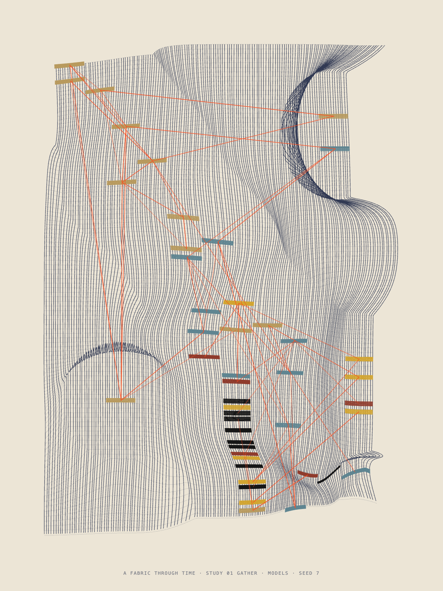

A plain cloth, gathered by stitches that run across time.

- **Warp:** the twelve places, a block of 13 threads each, ordered left to right by earliest record.
- **Height:** time, oldest at the top. Positions are half true dates and half plain record order (`timeWarp: 0.5`), so the long early silences show without crushing the 1800s into a sliver.
- **Coloured bands:** one per record, across its own place only. This is the documented layer.
- **Orange stitches:** one per link. Each pulls its two ends towards each other, harder for a stronger link, and the cloth around them puckers. Where stitches crowd, they share the slack.
- **Ground weft:** evenly spaced filler. It carries no data.

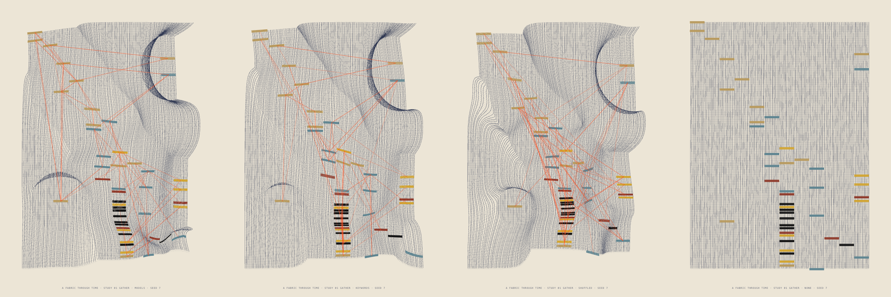

*Models, keywords, shuffled, none.*

## 02 Meander

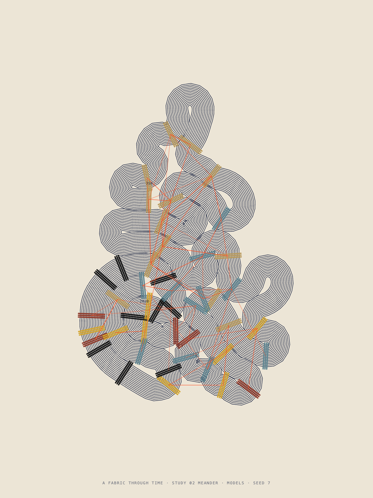

Time as one narrow band of cloth, laid out oldest to newest, then pulled into folds wherever a reading links two distant moments. The ends are marked 350 and 2020.

- **Band:** the 46 records in date order. The length between neighbours grows with the years between them (to the power 0.6).
- **Coloured bands:** one per record.
- **Orange stitches:** one per link, drawing its two records together until the band lies beside itself.
- The band resists creasing and resists lying on top of itself. Everything else about its path comes from the links. With no links it stays a straight strip: time as sequence only.

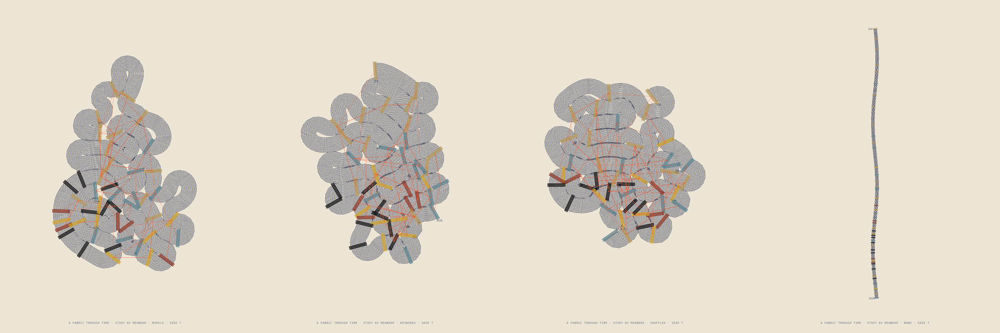

*Models, keywords, shuffled, none.*

## 03 Hold

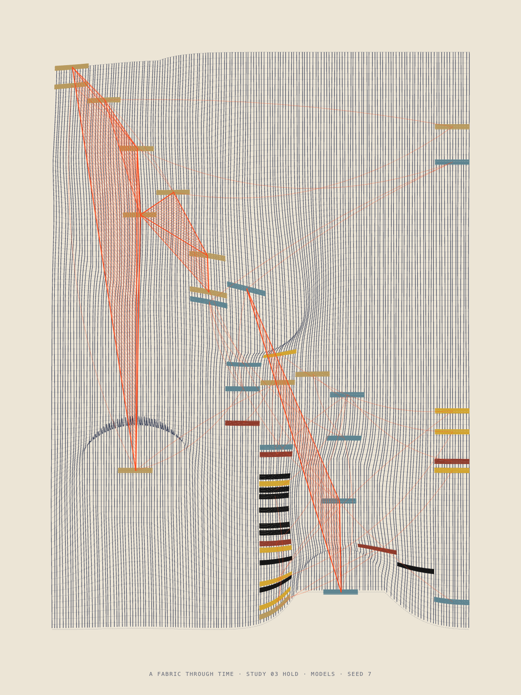

Made in answer to the weakness of the first two: under them, a shuffled reading looked as lively as the models' one. Here a link only takes tension when other links back it up.

- **Warp, height, coloured bands:** as study 01.
- **Held links:** a link is held when its two records are both linked to some third record. Held links are drawn taut and are the only ones that gather the cloth.
- **Woven patches:** three records that all hold each other are cross-hatched shut.
- **Slack threads:** every other link hangs loose and moves nothing.

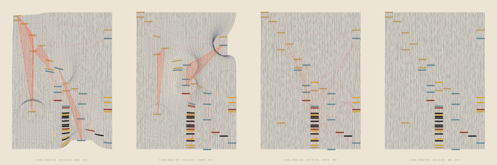

*Models, keywords, shuffled, none.*

Why this separates the readings: links that mean something tend to agree with each other, and random ones rarely do.

| Reading | Held links, of 50 | Triangles |
|---|---|---|
| Models | 16 | 7 |
| Keywords | 6 | 2 |
| Shuffled, seed 7 (shown) | 0 | 0 |
| Shuffled, average of 1,000 draws | 5.0 | 1.7 (200 draws) |

Seed 7 is a kind draw for this comparison: it happens to have no held links at all. A typical shuffle has a few, so a typical shuffled cloth shows one or two small tucks. 7 of the 1,000 shuffles had 16 or more held links, the models' figure.

What it shows about the models' reading, which is less flattering:

- **Six of the seven woven patches join settlement records to settlement records,** and the seventh joins three river records. The cloth is held together in the early centuries and along the river, and nowhere else. No patch crosses strands.
- **34 of the models' 50 links stay inside one strand** (a shuffle averages 9.4, and never passed 17 in 1,000 draws). The judges never saw the strand labels, so they found the strands again on their own. That is evidence they read the records sensibly. It also means they mostly did not do what the thesis hoped for, which is to connect across the categories the project started with. Only 16 links cross strands.

## Colour

Authored, not derived from data. Indigo warp on an undyed ground. Record bands by strand: river (blue-grey), settlement (stone), textiles (madder red), rubber (carbon black), people (weld yellow). The models' affinities are a synthetic orange that sits outside that palette, so the interpretive layer can't be mistaken for the documented one.

## What these first two show, and don't

Written by Claude on 13 October 2026, straight after making the first two. Study 03 came from the second point.

- **Both pass the removal test trivially.** With no links, Gather is a flat cloth and Meander is a straight strip.
- **Neither clearly passes the shuffled test.** In both, the shuffled version is as lively as the models' version. Nearly every record gets a stitch under every reading, so the cloth puckers everywhere either way; what changes is direction and which moments touch. A viewer can't yet see the difference between a meaningful link and an arbitrary one. That is the main thing to fix in the grammar.
- **Gather's crescents are fold-overs,** where the cloth is dragged past itself. They are the most striking marks and they come from the pull settings, not from any particular link.
- **Meander can't satisfy most of its links.** 50 links on one band is too many to bring every pair together, so many stitches stay stretched across the knot, and the band overlaps itself in places despite the rule against it.
- **All of experiment 01's caveats carry over:** a small corpus of modern paraphrases, judges from one model family, authored focal years and site groups.
- **Claude chose both grammars and wrote the code.** By the thesis's own standard that is not the AI contribution that matters, and the mappings are James's to keep, change or throw out.

Things to try next: fewer, stronger links (only those both models agreed on); letting link strength alone decide what is visible, so weak links leave the cloth nearly flat; pulling only across time in Gather so places stay as straight warp; a Meander with documented same-place links as a second kind of stitch.

## James's response to the first three (13 October 2026)

> its nice [...] it doesnt emote anything tough and perhaps is taking fabric too literally. When I think about the amount of time, years, months, days, minutes and seconds that has passed through just this town and how it evolved and shifted with the time it fills me with awe and a desire to explore, to unpick and unravel each thread to find out where it goes and why. these visuals are lovely but they dont convey a sense of place or really even time. I am intrigued but im not in awe.

## 04 Days

Made in answer to that response. It drops the cloth and tries one thing: the scale of time, in this place.

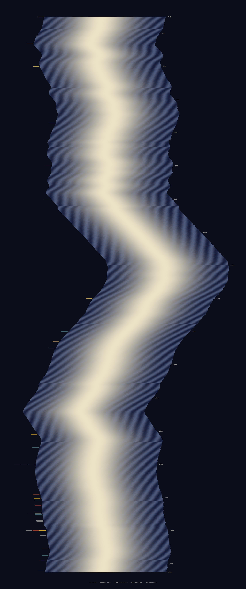

Every day from the start of 350, the year of the earliest record, to 13 October 2026, the day it was made: 612,433 days.

- **Rows:** one per year, oldest at the top. The last row stops partway, at the day of making.
- **Columns:** the day of the year, 1 January at the left.
- **Each cell:** that day's light at Bradford-on-Avon's latitude. Long days are pale and short days dark, so the bright band down the middle is every summer and the dark edges every winter. In the long nights the moon's phase lifts the dark a little, which makes the fine slanting grain.
- **The shape:** each row is shifted sideways by the River Avon's real course, so time runs down the river with upstream at the top. One pixel is 2.28 metres of river.
- **The threads at the left edge:** one for each of the 46 records, in its strand's colour, at the year it describes.

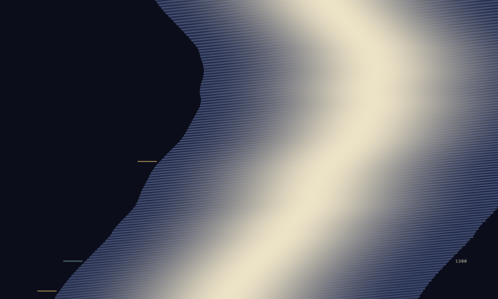

Run it with `node studies/04-days/render.mjs --png`. It is a raster image, so it is not in the browser viewer yet. Printed at one millimetre per day it would be 37 cm across the days and 1.68 m tall.

Notes and limits:

- **It uses none of the models' links.** By the thesis's removal test it fails outright; nothing in it came from an AI reading of the records. It is a test of whether scale alone carries feeling, before the relationships are brought back in.
- **The records know a year, not a day,** and the year is the single focal year chosen in experiment 01. A thread marks a year's row and nothing finer.
- **The light is calculated, not recorded.** Day length comes from latitude and the date, with today's tilt of the Earth and no weather. The moon uses the average lunar month counted back from 2000, so its phase drifts from the true one in the early centuries. Dates use today's calendar throughout, not the one in use at the time.
- **The reach of river is Claude's choice:** 11.5 km of the Avon from about 51.353°N 2.176°W down to 51.338°N 2.294°W, stopping before the river turns north. James knows where the town's river begins and ends better than a bounding box does.
- **The river's shape is slightly stretched,** because rows follow distance along the river, not a straight map axis.
- River course from OpenStreetMap (`data/river/avon-course.json`), © OpenStreetMap contributors, under the Open Database Licence.

## James's response to Days (13 October 2026)

> nice, I like it, I dont love having written dates etc it removes from the art - i wonder if we can use grid lines or sections to part the years. another reference to deep dive into is Giorgia Liupi
>
> what I like - the drama from the river and starting to get a sense of epicness
> what i think is missing - it feels like it lacks detail, it looks like a blurry gradient - we've lost all of the sense of data and connection and differentiation. The overall shape is visually pleasing but it now conveys nothing beyond a shape of a river

## 05 Threads

The river of days, with the records and their links put back in it and all lettering taken out.

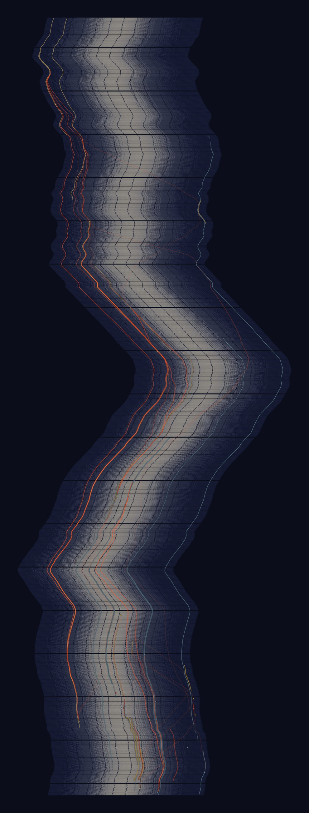

- **Ground:** every day from the start of 230 to 13 October 2026 as a dot: 656,262 of them. Rows are years and columns are days of the year. The dot is larger and paler the longer that day's light.
- **Gaps instead of dates:** a dark column between months, a hairline between decades and a wider break between centuries. There are eighteen century breaks down the piece.
- **Shape:** rows shifted sideways by the River Avon's real course, as in study 04.
- **Threads:** one per record, in its strand's colour, running down the river for the whole span of years the record describes. Some describe a single year; one runs for more than a thousand. Where the source is vague about a beginning or an end ("medieval", "before 1856"), that end of the thread is broken into dots. A thread that reaches the top edge began before the frame.
- **Knots:** the single year experiment 01 filed each record under.
- **Lanes:** threads from the same place run side by side, so the eighteen Kingston Mill records travel as one bundle.
- **Orange currents:** one per link in the chosen reading, drifting across the river from knot to knot. Bright if other links back it up (study 03's rule), faint if not.


Run it with `node studies/05-threads/render.mjs models 7 --png`. The first argument is the reading.

Notes and limits:

- **The spans are new data, and Claude's reading.** `data/described-spans.json` turns each record's free-text "date described" into a from and a to. Whole centuries stand in for phrases like "13th century". Nobody has checked them against the sources.
- **The frame now starts at 230,** the earliest year any span names, instead of 350.
- **Lane position across the river means place, but the ground's columns mean day of the year.** A thread's sideways position says nothing about the season. Two meanings share one axis, which is a weakness.
- **The removal test is back in play:** with reading `none` the orange currents vanish. The threads and the ground stay, because they come from the records and the calendar, not from the models.
- **The shuffled reading still looks plausible at a glance.** At seed 7 all 50 of its currents are faint, since none back each other up, but they cross the river just as gracefully.
- All of study 04's limits on the light, the calendar and the choice of river reach still apply.

## James's response to Threads and the seeded studies (13 October 2026)

> this is looking really nice.

> interesting experiment but i think I preferred the direction you were going. I'd like to take that and then play with the colours. I'd love to try some combinations from The Dictionary of Colour.

## 06 Colour

Study 05, Threads, redrawn in four-colour combinations from Sanzo Wada's *A Dictionary of Colour Combinations*. Nothing about the form changes; only the colours do.

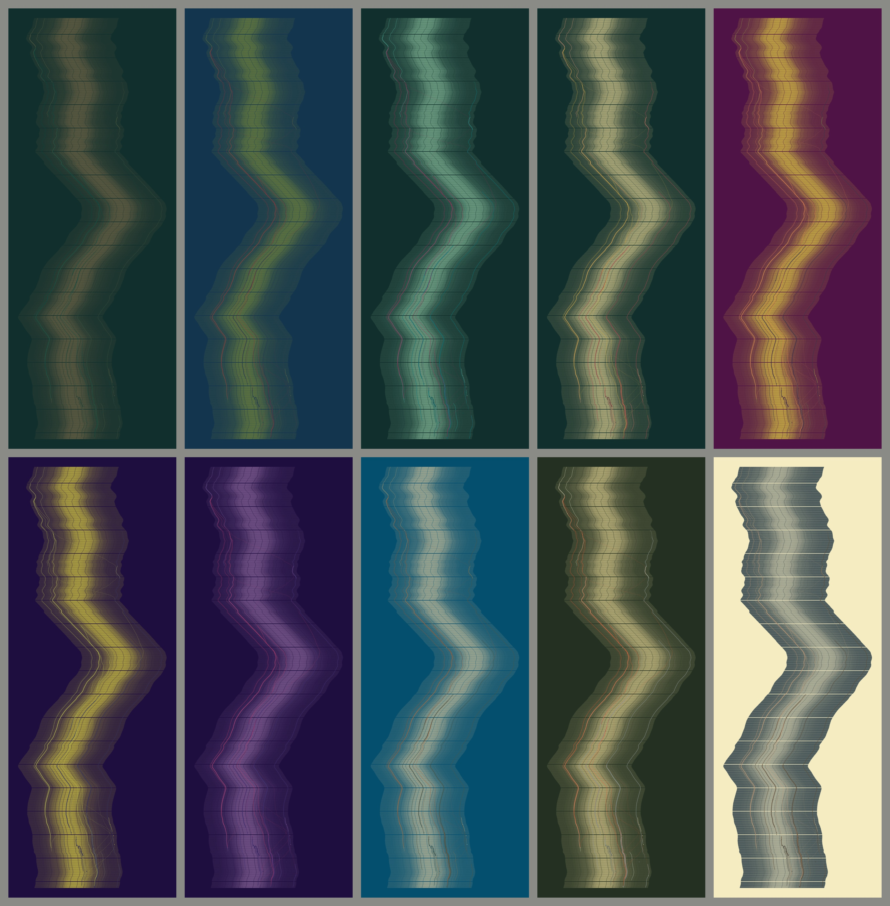

*Top row: combinations 78, 5, 31, 85, 13. Bottom row: 49, 91, 103, 63, and 56 on a pale page.*

The 108 four-colour combinations were read from the swatches in the Figma community file James pointed to, and are saved in `data/colour/wada-four.json`. The numbers are each swatch's position in that file, counting along the rows. They are not the combination numbers printed in the book.

How a combination's four colours are given their jobs (authored, and the same rule for every combination):

- **Darkest:** the page, and the dark edge under each thread.
- **Lightest:** the long days down the middle of the river.
- **Of the two left, the more vivid:** the models' currents.
- **The other:** the records' threads. The five strands are steps from that colour towards the lightest.
- Short days and the moon are mixes of those four, so nothing outside the combination appears.

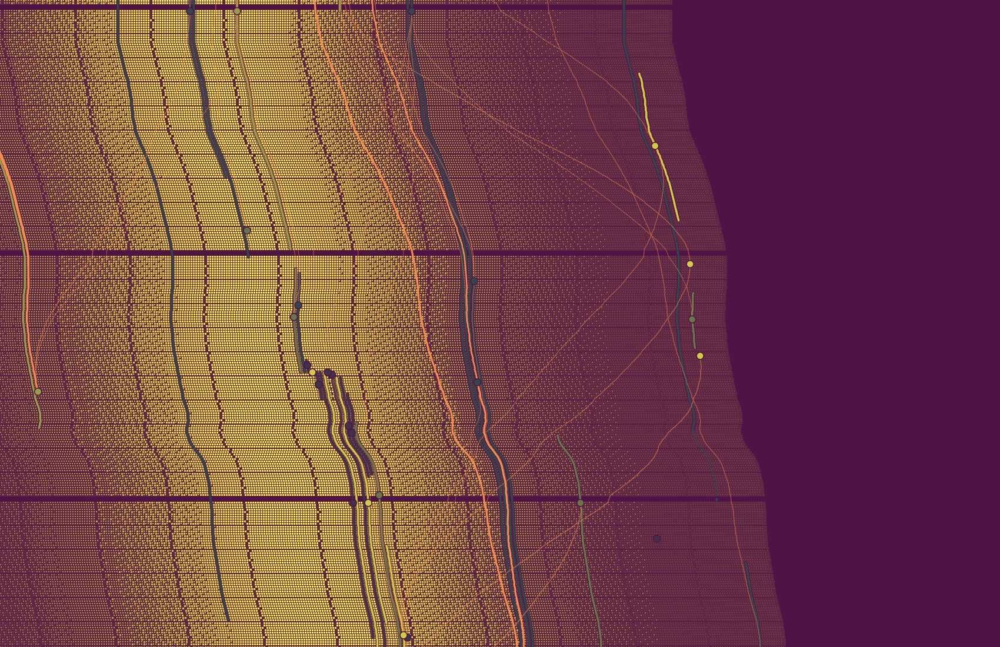
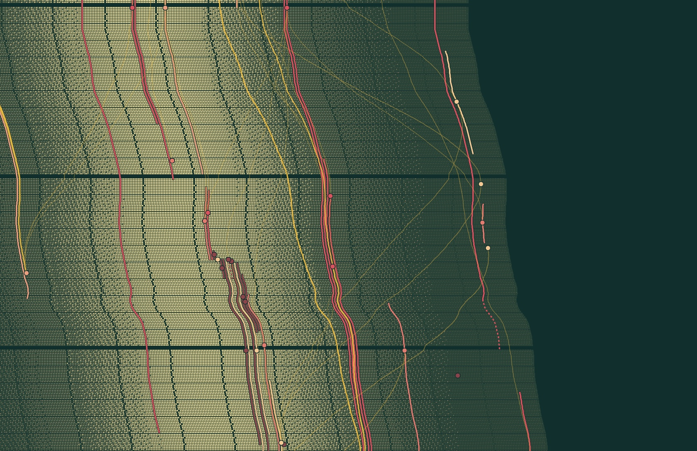
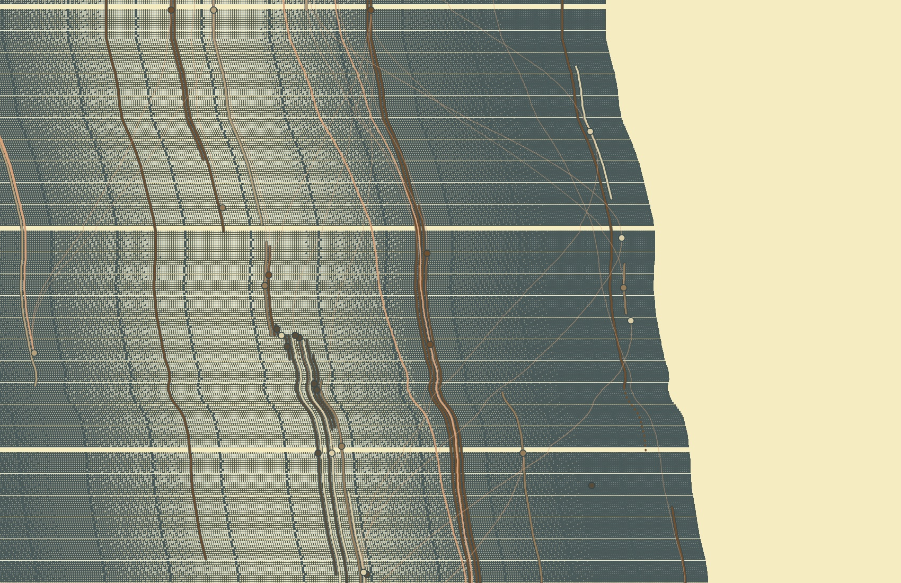

Run it with `node studies/06-colour/render.mjs` for this set, or name any combinations: `node studies/06-colour/render.mjs 78 13 56L`. Add `L` to put a combination on its lightest colour as the page.

Notes and limits:

- **The ten were picked by Claude's eye** from the 108, leaning towards combinations with one clearly dark colour for the page. The other 98 are untried.
- **The strands are now tints of one colour,** so they are harder to tell apart than in study 05, where each had its own hue. Four colours cannot give five strands, a ground and the currents a hue each.
- **Which colour gets which job is a mechanical rule,** not a judgement about each combination. Some would look better with the jobs swapped by hand.
- **The colours are the Figma file's screen values,** sampled from an image of it. They were not checked against the book.

### Pale paper

James, on seeing the first sheet: "when the paper is the lightest colour it works best". So, ten more with the lightest colour as the paper:

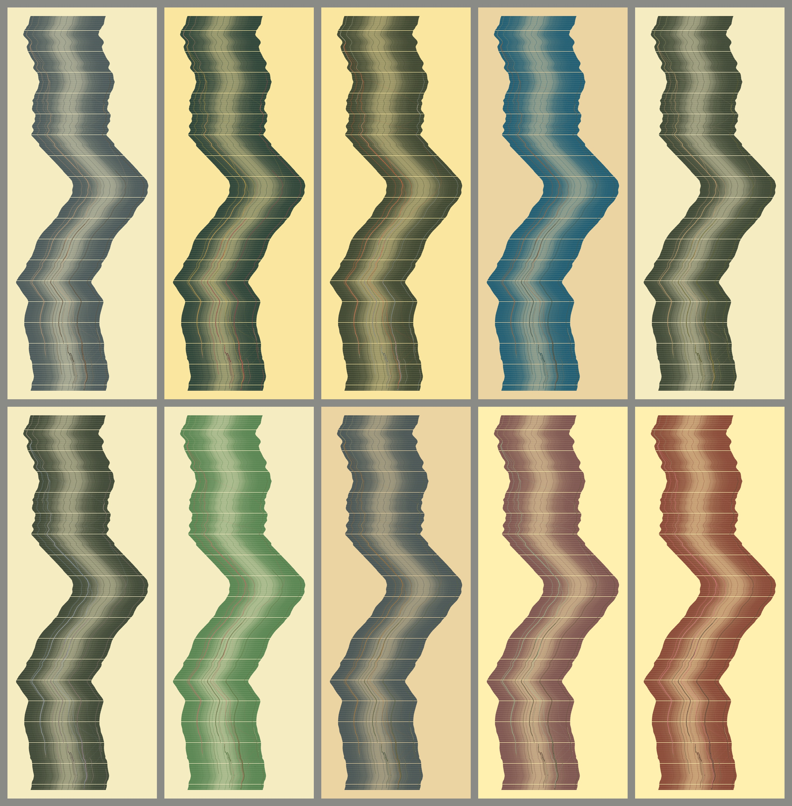

*Top row: combinations 56, 85, 63, 103, 70. Bottom row: 81, 30, 3, 50, 96.*

Made with `node studies/06-colour/render.mjs 56L 85L 63L 103L 70L 81L 30L 3L 50L 96L`.

- **The river now reads as a solid dark shape on the paper,** which gives the silhouette more weight than the dark pages did.
- **The threads and currents are weaker here.** Inside the dark strip they are tints and mid-tones on a mid-tone ground, and at sheet size they nearly vanish. The colour rule was built for dark pages and has not been reworked for pale ones.
- **The middle of the river goes grey-green in several,** because pale dots sit on a dark bed and the eye mixes them.

## James's response to the pale-paper colourways (13 October 2026)

> hmm yeah not working. lets go brighter. love this anna lucia piece

He attached a screenshot of a work by Anna Lucia: columns of flat, bright blocks on pale paper, many of them two colours mixed in a fine checker. The image is not stored here because it is her work.

## 07 Bands

The river of days on pale paper, in flat bright colour. The days themselves now carry the records, so the separate threads of study 05 are gone.

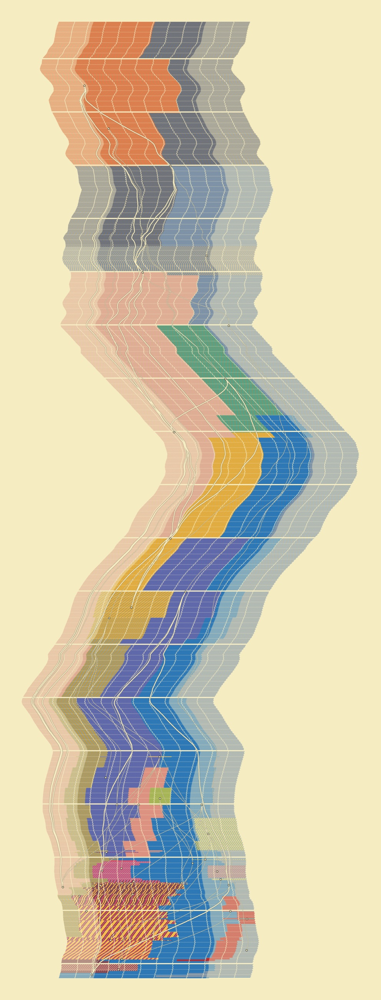

- **Ground:** every day from 230 to 13 October 2026 is still one square, 656,262 of them. Rows are years, columns are days of the year, and the river's course shifts each row. The gaps between months, decades and centuries are bare paper.
- **Bands:** in each year the row is shared out among the places that have a record describing that year, in proportion to how many. A place keeps its left-to-right order and its colour all the way down. A band begins where a place's first record begins and steps wider or narrower as records start and stop.
- **Weave:** inside a band every other square takes the colour of a strand (river, settlement, textiles, rubber, people) of the records there. So each block is two colours mixed by the eye: place as warp, strand as weft, which is the rule experiment 01's test cloth began with.
- **Knots:** each record, at the year experiment 01 filed it under.
- **Tracks:** the models' links, drawn in the paper's colour as if a thread had been pulled out of the cloth. Wide if other links back it up (study 03's rule), fine if not.

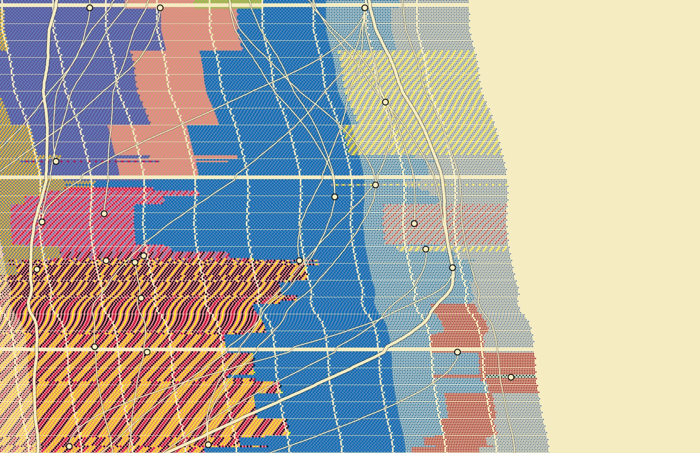
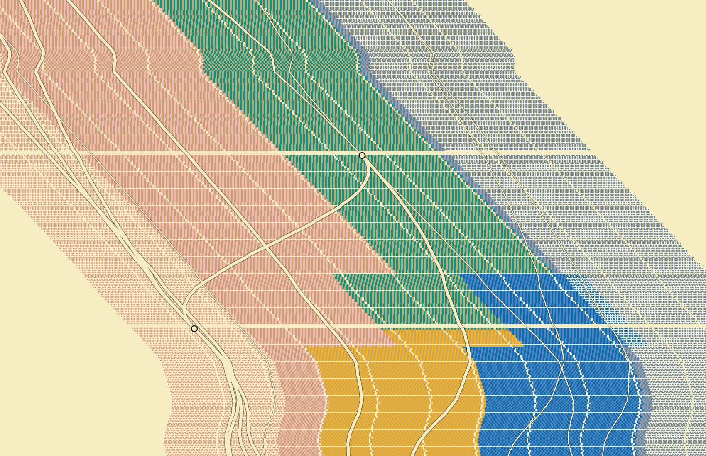

Run it with `node studies/07-bands/render.mjs models 7 --png`.

Notes and limits:

- **How close this is to the Anna Lucia piece.** What is taken from it is general: pale paper, flat saturated colour, and two colours mixed in a checker, which is also simply how woven cloth mixes colour. The layout is not hers: here it is the river's course, the calendar and the records' spans that decide where every block falls. But the family resemblance is deliberate and should be said out loud.
- **A band's width is a share of the records, not a share of history.** Kingston Mill fills the 1800s because the research looked hardest there. The thesis warns about archive density turning into visual weight; this study shows that density openly but does not correct for it.
- **A square's colour does not mean that day belonged to that place.** The year's days are only being used as the units a year is shared out in.
- **The palette is Claude's choice:** twelve place colours and five strand colours, each one a colour that appears somewhere in Wada's combinations, but together they are not one of his combinations. The early centuries come out duller than the rest because the stone colour used for the settlement strand greys whatever it is woven with.
- **The slanting stripes in the Kingston Mill block** come from the order in which strands take turns, not from anything in the records.
- **Shuffled links still look plausible.** At seed 7 they are all fine tracks with no wide ones, but they cross the river just as easily.
- The spans, the light, the calendar and the river reach carry the same limits as in studies 04 and 05.

## James's response to Bands (14 October 2026)

> okay love it. new experiment - if we were to remove the river motif and plot on a map or a map of the town over time or something more location based how would that work

Claude proposed three ways (time as height above the map, time as rings around each place, time as a sequence of maps) and recommended rings. James: "lets try it".

## 08 Rings

The river motif set aside for a plan of the town. Each place grows rings, one per year, but only for the years some record describes it.

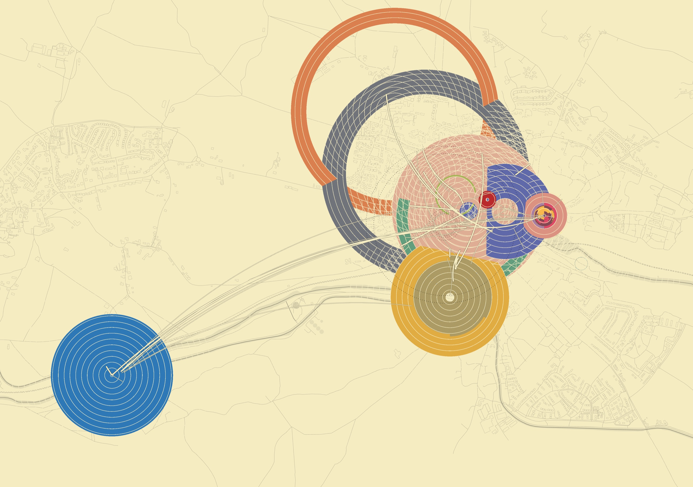

- **Plan:** today's buildings, roads, railway, river and canal from OpenStreetMap (`data/town/plan.json`), drawn faint.
- **Places:** eleven of experiment 01's twelve places, located with OpenStreetMap (`data/places.json`). Four are approximate stand-ins, and the file says which and why.
- **Rings:** the present is at each place's centre and the deep past is the widest ring, so the same distance from a centre is the same year at every place. A place with old records is a wide hoop; one whose records are all recent is a small disc. Colours are study 07's: the place's colour woven with the strand colours, the ring shared out between that year's records as wedges.
- **Gaps:** a hairline of paper at every century. Where places overlap, their century lines cross into a lattice.
- **Overlap:** where two places' rings cover the same ground, the more recent year lies on top.
- **Town-wide records** have no single place. Each is a fine dashed circle around the middle of the located places, at the radius of its year.
- **Tracks:** the models' links, in the paper's colour, leaving each record's ring on the side facing the other record. Links within one place run straight out along a radius.

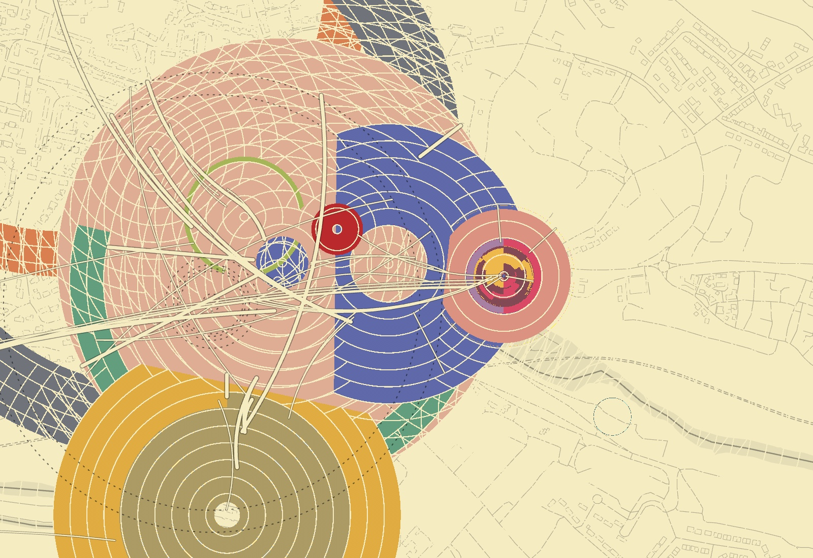

Run it with `node studies/08-rings/render.mjs models 7 --png`.

Notes and limits:

- **The rings' size is time, not area.** A 600-pixel ring is about 600 metres on the plan, but it means 1,796 years, not a place that large. Big rings cover ground that has nothing to do with them.
- **The town centre is crowded.** The two churches, Abbey Mill, Middle Rank and Town Bridge are all within about 250 metres, so their rings pile up. More recent years on top is a rule for reading the pile, not a fact about the town.
- **The plan is today's town.** The buildings and roads under a ring for the year 700 are modern. A map that changes with time would need historic maps, whose licences have not been checked.
- **Four locations are approximate:** the Roman villa (the school's centre, not its pitch), Budbury hillfort (the middle of the Budbury streets), Kingston Mill and The Hall (midway between them) and Greenland Mill (the street named after it).
- **Every year inside a span is drawn as recorded.** A ring says a record describes that year, not that anything happened in it.
- **Shuffled links still look plausible** (rendered alongside, not shown). The rings themselves come from the records and do not change with the reading.

## Seeded studies

Five more, each made by a separate agent from a random string: see [`seeds/`](seeds/README.md).
