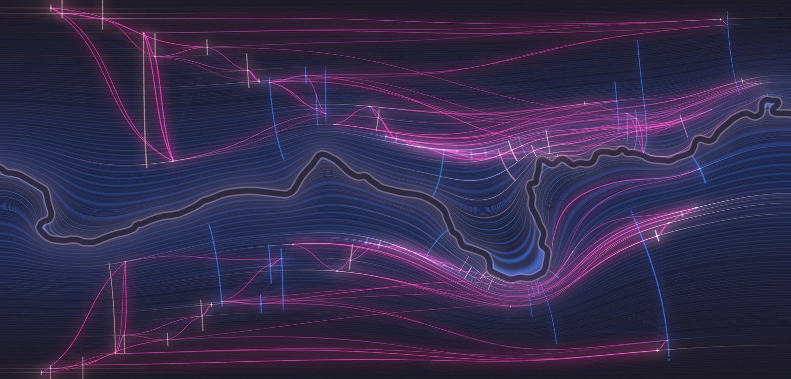

# Seed study A: Shores



The River Avon is left out of the picture: it is the dark gap. Time recedes from it on both banks. Every year since 230 is one shoreline, the present hugging the water and the oldest years lying flat along the top and bottom edges. The upper bank shows one model's reading of the 46 records and the lower bank shows the other's.

Run it with `node studies/seeds/a/render.mjs`. It writes `out.png` (4000 x 1920) and `preview.png` (1600 x 768). The first run takes about three minutes, most of it solving the two fields; they are then kept in the system temp folder and later runs take about twenty seconds. No randomness is used, so every run gives the same image.

## The string

```
qazMmJEcFdYl09ge1TioIq5sTCfX2pO36DyIK26AqjoAYHB898M97Av6I5LEBuEhSRGiqucjqf3aySuxmLUVtg2PopynO4NKU0itpf0mpA9QD4JDxk4ESFBUwQPtLtRj
```

Made, before reading anything about the project, with:

```
LC_ALL=C tr -dc 'A-Za-z0-9' < /dev/urandom | head -c 128 | tee seed.txt
```

It was generated once and not regenerated. `render.mjs` reads `seed.txt` for the digits; the colours are typed into the script as the hex runs listed below.

## What I noticed, and what each became

| In the string | Decision |
|---|---|
| **Exactly 52 capitals and 52 lower-case letters** (and 24 digits). A perfect balance of two kinds. | Two equal halves, upper and lower: the two banks. The data has one thing that comes in an equal pair, the two models that read the records blind. Upper bank = model A, lower bank = model B. Where they agree the banks mirror each other; where they differ, they don't. |
| **Four characters never appear: `W`, `Z`, `b`, `r`.** No b and no r in a string for a town whose name starts "Br", on a river. | The river is not drawn. It is the one unlit thing in the frame, and everything else is shaped by it. |
| **Six runs of three or more hexadecimal characters:** `EcFd`, `36D`, `26A`, `B898`, `97A`, `f3a`. Read as CSS colours they are pale lilac, bright blue, deep blue, dusty rose, muted violet and hot magenta. | The whole palette. Five quiet colours for the five strands (people `#EcF`, river `#36D`, rubber `#26A`, settlement `#B89`, textiles `#97A`), and the one loud colour, `#f3a`, for the models' links. The ground runs from `#36D` at the water to `#97A` in the far past, and the water's edge is `#EcF`. The alpha digits of the two four-character runs are ignored. Apart from the near-black ground and a white point at the centre of each bead, every colour in the image is one of these six. |
| **The 24 digits, in order: `0 9 1 5 2 3 6 2 6 8 9 8 9 7 6 5 3 2 4 0 0 9 4 4`.** There is a swell in the middle, `2 6 8 9 8 9 7 6 5 3 2`, that rises and falls like a wave, with sharp spikes either side. 24 years is also about one human generation. | The rhythm of the ground. Each year's line takes its brightness from digit number (year mod 24), so the swell repeats every 24 years: about 75 generations between the far edge and the water. |
| **128 characters is 2 to the 7th, and 128 x 14 = 1,792**, within five years of the span from 230 to today (1,797 years). | Not much, honestly. It persuaded me to make the picture about the full span rather than a sample of it, and to keep the frame at 230, but no measurement in the image comes from it. |
| The string opens `qaz`, the left-hand column of a keyboard read top to bottom. The trigram `2po` / `2Po` appears twice, 58 characters apart. The longest run of one kind is seven lower-case letters, `iqucjqf`. | Noticed and not used. |

So the direction was: a dark image in blue, violet and rose with magenta as the only hot colour; two mirrored halves either side of a missing river; and a ground that pulses in a 24-year wave.

## Data to form

- **Shape.** The Avon's real course from `data/river/avon-course.json`, 8.8 km of it, at 2.2 m per pixel. The map is turned 2.1 degrees so the river's general line runs level, so north is 2.1 degrees clockwise of straight up; east (upstream) is on the right. The mapped centreline has its corners rounded slightly. A band 11 pixels either side of the centreline is left dark, which is wider than the real river.
- **Time.** On each bank a harmonic field is solved: zero at the river, one at the far edge of the frame. Its level lines are years. The present follows every bend of the water; by the year 230 the bends have smoothed out into a straight line. Years near the present get more room than old ones (a square-root scale), because 34 of the 46 records fall after 1600.
- **Ground.** One line per year where there is room, merging into the 24-year swell where there is not. A dark break at every century, eighteen of them on each bank.
- **Records.** Each record is a thread running straight away from the river, across the years its source describes (`data/described-spans.json`). An end the source leaves vague is broken into dashes. A thread that touches the water runs to the present; one that reaches the outer edge began before 230. Its colour is its strand.
- **Each record's year.** The single year experiment 01 filed the record under gets a bead on the thread, and lights that year's shoreline for some distance both ways, so a record leaves a faint river-shaped line across the bank.
- **Place.** Records from the same place run side by side. The twelve places are spaced along the bank in the order they are listed in `data.json`.
- **Magenta links.** Every pair of records a model scored above zero: 102 for model A on the upper bank, 86 for model B on the lower. Thickness and brightness follow the strength, 1 to 5; strengths of 4 and 5 also glow (17 on the upper bank, 16 on the lower). A link leaves along its record's shoreline, crosses the years in between and arrives along the other's.
- **Faint blue hairlines.** The 279 pairs whose keyword similarity `t` is at least 0.035, brighter the more words they share. These are the same on both banks.

## What works and what doesn't

Works:

- **The river does the drawing without being drawn.** The strongest part of the image is the middle, where the shorelines pile up inside the big bend and fan out past it. The detail at full size holds up: individual years are visible near the water.
- **It looks like nothing in studies 01 to 05.** The palette, the dark ground and the two-bank layout all came from the string and I would not have chosen them otherwise.
- **The two models can be compared by eye.** The banks are recognisably the same structure with different links. Model A's bank is visibly busier.
- **Links read as currents.** Because they travel along shorelines before crossing time, bundles of them take on the river's shape.

Doesn't:

- **The outer edges are still a chart.** Far from the river the field is flat, so the oldest records sit as vertical bars with horizontal lines through them. The awe is in the middle third; the top and bottom are a graph in the dark. A tighter crop, or an outer boundary that is not a straight line, would help.
- **Position along the bank is not geography.** The places are in list order and evenly spaced, not where they stand on the real river. The river's shape is true; where a record sits along it is not. This is the biggest gap between the picture and "a sense of place", and the data has no coordinates to fix it with.
- **The two banks are not exact mirrors.** A lane is placed by the field on its own bank, so the same record meets the water at different points on the north and south sides.
- **Three of the five strand colours are hard to tell apart.** The two blues are close, and lilac and rose both go near-white where a thread is bright. The string gave five colours and I kept them as given; a designer would have moved them apart.
- **It uses more links than the earlier studies.** Studies 01 to 05 use the 50 links that pass experiment 01's century rule. This uses every pair either model scored above zero, including pairs close in time or from the same page, so its links are not comparable with theirs, and there is no shuffled control here. I have not tested whether a shuffled version would look as good; I expect it largely would.
- **The 24-year swell carries no historical meaning.** It is the string's rhythm laid over real years. Likewise the square-root time scale and the width of the dark river are my choices.
- **Awe at the amount of time is only partly there.** Every year is a line, but beyond a few centuries they are too fine to count and read as texture. The image says "deep" more than it says "1,797".
- All the caveats already in `studies/README.md` about the spans, the focal years and the judges apply here too. River course © OpenStreetMap contributors, Open Database Licence.
