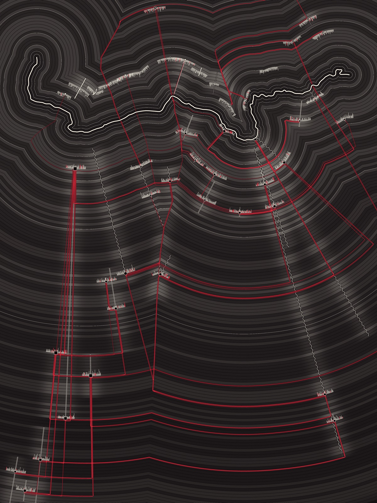

# Seed study B: Ford



The River Avon drawn once, in plan, north up. Every year since 230 is a ripple that has left the river and is still travelling outward: the present is at the water and the oldest year is furthest from it. The 46 records lie on the ripple of their year, and the models' links run through time and along the ripples between them, in red.

Run it with `node studies/seeds/b/render.mjs`. It writes `field.png` (the ripples), `out.svg` (the vectors over them), `out.png` (3000 x 4000) and `preview.png` (1200 x 1600). No randomness is used, so every run is identical. `--no-png` skips the Chrome step.

## The string

```
761Nt6oIvXBCUWiaWx1BZy6s5IMhB0EmL17jw8xpHXB5gd2O8hF2q1TORK4XX2FetWaFo3sxuOvdnaujFn7AWQKhy3RdE6LulyVjdxQr7VFJsk2mp9SnDQI5OQPHZWcd
```

Made with this, before reading anything about the project, and not regenerated:

```
LC_ALL=C tr -dc 'A-Za-z0-9' < /dev/urandom | head -c 128 > seed.txt
```

It is kept in `seed.txt`, and `render.mjs` reads it from there.

## What I noticed, and what each thing became

| In the string | Decision |
|---|---|
| **128 characters, which is 2^7.** Once I had read the data: 128 x 14 = 1,792, and the frame from the earliest described year (230) to 2026 is 1,796 years. | Each character owns **14 years**. The ripples are parted into 128 bands of 14 years by a dark seam, in place of decades and centuries. The seven doublings (14, 28, 56, 112, 224, 448 and 896 years ago) are drawn as bright unbroken ripples; they crowd towards the river and thin out with depth. |
| **It opens with the digits 761**, the only run of three digits. 761 nm is the far-red edge of visible light (the oxygen band in sunlight), where colour is about to stop being seen. | The one colour in the piece is a **far red**, and it is given to the interpretive layer only: the models' links. |
| **G, Y, b, f and z never occur.** | No green and no yellow, which rules out the weld yellow and the river blue-green of the earlier studies. I read b and f, more loosely, as no blur and no fills: every mark is a line. (z gave me nothing.) |
| **The three most frequent characters are W, d and F**, five times each. | **Three inks: White, dark, Far-red.** With colour unavailable for the five strands, they are told apart by the **kind of line** instead, five kinds for the count of five. |
| **X occurs four times: twice in "XB" (the only repeated pair, 32 places apart) and once doubled, "XX".** An X is a crossing, and Bradford is the broad ford. | The composition is a crossing. Time runs at right angles to the river, not along it as in studies 04 and 05. Records sit on **two banks**, so some links must **ford the water**. Each link is **two strands, one per model, that cross once** (the doubled X). And a link turns a right angle: through time, then along a year. |
| **Upper case, lower case and digits alternate in short runs** (53, 49 and 26 characters; the longest runs are six). | The rhythm of the bands. A band whose character is upper case has full-weight year lines, lower case has thinner and fainter ones, and a digit has its year lines broken into dots. This is the only place the string, not the data, sets what a mark looks like. |
| The digits read in order contain **1650**, which is the focal year of one record (R03, Town Bridge). | Noticed, not used. It is a coincidence and I did not want to pretend otherwise. |

## Data to form

- **River:** `data/river/avon-course.json`, all 418 points, equal scale both ways, north up. One pixel is about 3.7 m.
- **Ripples:** a pixel's distance from the river is its age: 1.72 pixels per year, so there are 1,796 year lines. Near the water a ripple keeps every bend of the river; far from it the bends have smoothed away. The creases are where ripples from two bends meet.
- **Brightness of a ripple:** how many records describe that year (from `data/described-spans.json`), plus a local glow beside each record whose span covers it. Years nobody describes stay dim.
- **Banks:** the people and rubber strands are on the north bank (17 records), the river, settlement and textiles strands on the south (29). Along each bank, records are in the order of `groups` in the data, left to right, with the oldest record of each place in the middle of its place.
- **Knot:** a record's focal `year`, on that year's ripple. Shape is the strand (ring: river, square: settlement, diamond: textiles, solid disc: rubber, ring with a dot: people). Size is how many links touch it.
- **Fringe:** the record's own `text`, one tick per word, running along the ripple of its year. Tick length is the number of letters; a sentence end leaves a gap. A tick is red if that word is one the record shares with a record it is linked to (`pairs.words`).
- **Span:** the years the record describes, drawn through time from the knot, straight towards the river for later years and following the ripples outward for earlier ones. Line kind is the strand (wavy: river, double: settlement, zigzag: textiles, heavy bar: rubber, dotted: people). A vague beginning or end is broken into sparse dashes.
- **Links:** the 50 links of the `models` reading. Each leaves the younger record, goes through time to the year of the older one, then runs along that year's ripple to it. One strand per model, its width that model's strength (`a`, `b`); the two cross where the thread turns. 29 links have both strands and 21 have one, which is a model that saw a link the other did not. 7 links join records on opposite banks and cross the water.

## What works, and what doesn't

Works:

- As an image it holds at two distances. From far off: the white river, the rings, the red structure. Close up: year lines, word fringes, the two strands of a link crossing. It is not a gradient.
- The river is a place here, a map you could recognise, and it also sets the shape of everything else, down to the bottom edge.
- Time is legible without lettering: the Roman and Saxon records are alone in the lower left, far from the water, with long red threads reaching up to them; the mills crowd the banks.
- The red fringe ticks show part of why a link exists, in the record itself.
- The split of a link into two models' strands shows agreement and disagreement, which the earlier studies averaged away.

Doesn't, or is doubtful:

- **Distance from the river means time, not distance.** The piece looks like a map, and a viewer may read the Roman villa as lying far to the south-west. Position along the bank comes from the order of places in the data, not from where they are. No site coordinates are in the data and I did not invent any.
- **The bank a record sits on is my rule (by strand), not geography.** It is what makes the fords, so 7 crossings are partly an artefact of that choice.
- **The band rhythm comes from the string, not from history.** A dotted or faint band says nothing about those 14 years. It gives the rings variety, and it could be mistaken for data.
- **The 14-year seams cannot be counted the way centuries can.** They part the years but give no foothold.
- **Year lines are 1.72 pixels apart,** crisp in `out.png` and lost in the preview, where only the bands survive. The piece wants to be large.
- **Three links are routed backwards** (from the older record to the younger one's year), because inside a bay of the river the ripples close over and cannot carry a thread outward. One link takes a long detour for a similar reason.
- **The removal test passes** (no links, no red, and no red ticks). **The shuffled test was not run.** A shuffled reading would very likely look as handsome; nothing in this form rewards links that agree with each other, as study 03's did.
- The lower right is quiet. That is honest (little is recorded there) but it is also where the composition is weakest.
- Fringes of neighbouring records overlap where several share nearly the same year, mostly around 1848 on the north bank.
- All of the earlier caveats stand: the spans are Claude's unverified reading of free-text dates, the focal years are authored, and the river reach is whatever the OpenStreetMap query returned (© OpenStreetMap contributors, ODbL).
