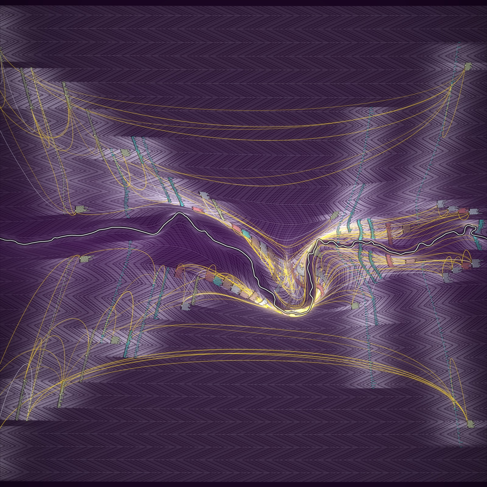

# Seed study C: Two Banks



The River Avon's real course runs across the middle. Every year from 230 to 2026 is one ring on each bank, the present at the water and the oldest years at the top and bottom edges. Each record is written twice, once on each bank. The north bank carries one model's links between the records and the south bank carries the other's.

Run it with `node studies/seeds/c/render.mjs`. It writes `out.png` (4000 x 4000) and `preview.png` (1600 x 1600), takes about ten seconds, and uses no randomness.

## The string

```
RZpCDfaLpwzzf8JIJfpc1VDd67i5n0uOk2krP15QZriYxPjLpt0whdgyqdNIKPsyjfMModxOYdl6lc7o4oHN4ddeekUCNszJC6v6Qtwb88pzjd8JCSZZlB4v4QgQzViB
```

Made with this command, once, before reading anything about the project. It is saved in `seed.txt`, which `render.mjs` reads.

```
LC_ALL=C tr -dc 'A-Za-z0-9' < /dev/urandom | head -c 128 > seed.txt
```

## What I noticed, and what each thing became

| In the string | Decision |
|---|---|
| **Seven mirror triplets:** `JIJ`, `k2k`, `l6l`, `o4o`, `6v6`, `4v4`, `QgQ`. Each is one thing with the same thing on both sides of it. | The whole composition is bank, river, bank. Everything documented is drawn twice, mirrored across the water. The two flanks are the two models: A's links on the north bank, B's on the south. Where they agree the picture is symmetrical, and where they differ it is not. |
| **Two of the triplets are `6v6` and `4v4`:** a V between equal numbers. | The ground pattern is a chevron. The rings' dashes slant one way for a century and the other way for the next, and the two banks mirror each other, so the slants meet in Vs. |
| **The 21 digits sum to exactly 100:** `8 1 6 7 5 0 2 1 5 0 6 7 4 4 6 6 8 8 8 4 4`. | The digits are a rhythm exactly one century long: on 8, off 1, on 6, off 7, and so on. Every year's ring is dashed with it, slid one step a year, so the pattern closes on itself once every hundred years. The century is the unit of the piece: a bright unbroken ring with a dark year either side. |
| **Exactly half the characters are lowercase** (64 of 128). | The river divides the picture in half, top from bottom. |
| **The three two-digit numbers are 67, 15, 88.** | Read as red, green, blue, they are the ground: a deep violet, `rgb(67, 15, 88)`, darkened with distance from the water. |
| **The two-character runs of hex characters, in order, are `f8 c1 15 c7 C6 d8 B4`.** | Taken three at a time they give `#f8c115`, an amber, and `#c7c6d8`, a lavender grey. Amber is every link both models made. Lavender grey is the rings. `B4` is left over. |
| **The longer hex runs are `CDfa`, `Dd67`, `4ddee`, `b88`.** | Read as three-character colours they give the five strands: river `#4dd`, people `#CDf`, settlement `#Dfa`, textiles `#d67`, rubber `#b88`. `#dde` is the river line and the links only one model made. |
| **Six doubled characters** (`zz`, `MM`, `dd`, `ee`, `88`, `ZZ`), and `d` is the commonest character. | Supports the doubling: 46 records, 92 drawings of them. |

Noticed and not used: the ten missing characters (`A E F G T W X m 3 9`), the three repeated pairs (`Lp`, `8J`, `JC`), and the length being 2 to the 7th with 7 mirror triplets.

The palette is nothing I would have picked. The existing studies use indigo, madder and weld on undyed cloth or night blue; this one is violet, amber and turquoise.

## Data to form

- **River:** `data/river/avon-course.json`, the same 11.5 km reach as studies 04 and 05, turned by a few degrees so the straight line between its ends is level. North is up and upstream is on the right. One pixel is 2.09 m.
- **Rings:** one per year per bank, 1,797 years, 1.08 px apart. Distance from the water is time: 2.26 m of ground for each year.
- **Forgetting:** a ring is not a plain offset of the river. It is offset from the river smoothed over a length 2.2 times the ring's distance from it. Rings near the water keep every bend. By the Middle Ages only the big meander is left, and the oldest rings are nearly straight.
- **Light:** a ring is lit, along its length, near the stations of the records whose described span (`data/described-spans.json`) includes that year. Everywhere else it is dim. A dated end of a span is a hard edge; a vague end comes up over 28 years.
- **Stations:** each record has a place along the river: the twelve places in experiment 01's order, each place's records side by side by the start of their span.
- **Records:** each is a spine running out through the years it describes, with one dash for every word of its text, each dash as long as the word. A record about a single year is a tight block of dashes. A record about a thousand years is a long ladder of single dashes. Colour is the strand. The ringed dot is the year experiment 01 filed it under.
- **Links:** every judged pair where a model gave a strength above zero. Model A's 102 are on the north bank, model B's 86 on the south. The 73 pairs both linked are amber on both banks; the rest are pale, on their own bank only. Width and opacity follow that model's strength. Each link hangs from its two records towards the water, lower the stronger it is.

## What works and what doesn't

Works:

- **The river is the drama.** The big meander pulls the rings and the links round it and the picture has a centre. It reads as a place before it reads as a chart.
- **It is dense and it is all data.** At full size there are about 2,200 word-dashes drawn twice, 188 links and about 3,500 rings, and no two records look alike.
- **Time has a shape.** The lit ground is what the records speak of and the dark is silence. The long dark bands at the top and bottom are the centuries nobody in this corpus describes.
- **The string took it somewhere new.** A square map-like field, a violet and amber palette, two models kept apart, records drawn as their own words: none of these are in studies 01 to 05.

Doesn't:

- **The two banks look too alike.** The models agree on 73 pairs, so the mirror nearly holds, and the pale one-model links (29 north, 13 south) are thin. The difference between the two readings, which is the idea of the piece, takes looking for.
- **Stations are an ordering, not geography.** The river is real but the records are not where their places are. The repo has no coordinates for the places, and most of them sit within a few hundred metres of each other, so real positions would stack nearly everything in one spot. Kingston Mill's 18 records happen to fall on the big meander, which is an accident of the ordering and says nothing about where the mill is.
- **The rings still fold in two places:** inside the big meander on the north bank and at the tight bends at the far right. The fold check counts 475 samples running backwards out of about 270,000. Records and links tangle there. More smoothing cures it and flattens the river, which is the worse trade.
- **Single years cannot be seen.** At 1.08 px a year the rings merge into a twill. Decades and centuries read as lines; years read as texture.
- **The chevron ground is cloth again.** It came from the digits, not from wanting cloth, but it does look woven, and from a distance the far field is a little murky.
- **Short spans are drawn too wide in time.** A block of fifty words needs about 45 px, so a record about one year covers about 40. The knot is at the right year; the block is centred on it.
- **Both models' links are shown at every strength, with no shuffled control.** This study does not run the removal or shuffle test. It shows what the two models said, side by side.
- The spans in `described-spans.json` are Claude's unchecked reading, as in study 05. River course from OpenStreetMap, © OpenStreetMap contributors, Open Database Licence.
