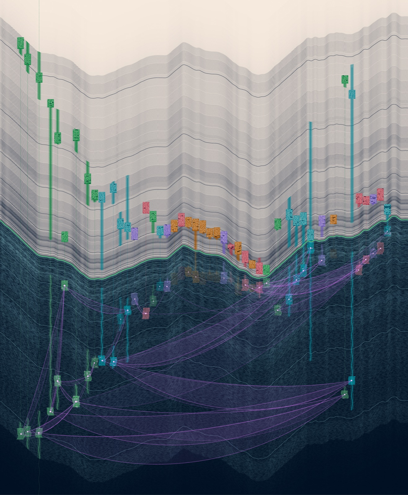
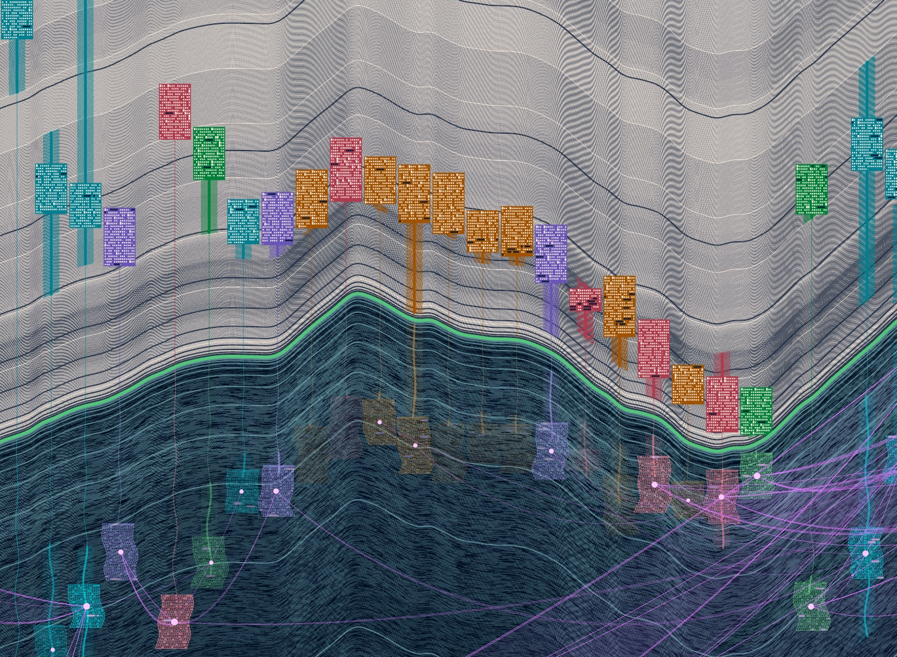
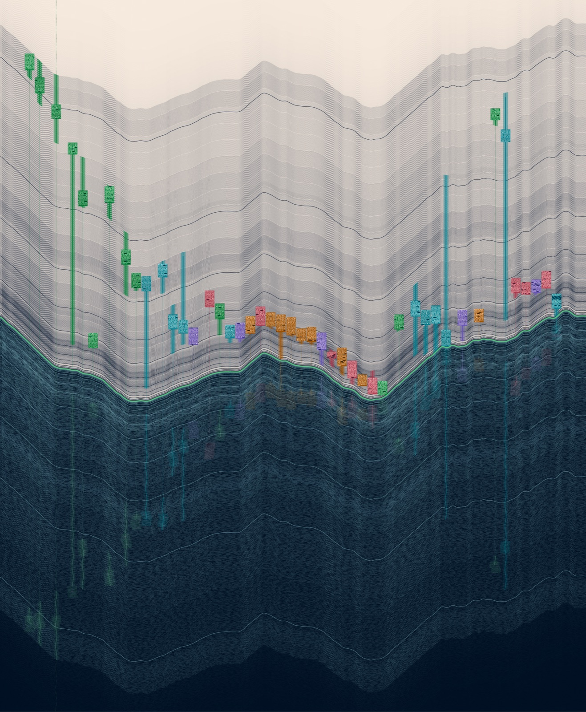

# Seed study D: Bank and Reflection



The River Avon is a waterline across the page. Above it, on a light ground and in straight strokes, is what the 46 records say. Below it, on a dark ground and in curves, is what two models made of them.

## The string

Made before reading anything about the project, and not regenerated:

```
LC_ALL=C tr -dc 'A-Za-z0-9' < /dev/urandom | head -c 128 | tee seed.txt
```

```
bhyBtsQlVAkybmkHWVXTgl2hEaEjw0fPRBnLbI3YOHjIXEKqADRP5FbhBzXGJC0rFqsK8ZlMtAwa6lLcporcR1BLKcEtvlpasquXpPXZxiWgTQSPU14dnJbKxlpJDtZp
```

## What I found in it, and what each finding decided

| Found in the string | Decision |
|---|---|
| **59 lowercase, 59 uppercase, 10 digits.** The two cases balance exactly. | Two equal halves with a line between them. Each year takes the same height above the line as below it. The two cases became the two kinds of thing the project holds: what is documented (upper) and what two models read into it (lower). |
| **The three commonest letters, ignoring case, tie at nine each: b, l, p.** A `b` turned over a horizontal line is a `p`. An `l` turned over is still an `l`. | The picture is a reflection in a horizontal line. Everything is a vertical stem: `b` is the stem standing on the bank, `p` is the same stem hanging in the water, `l` is the waterline. |
| **Twice a lowercase letter is followed straight away by its own capital: `lL` (position 77) and `pP` (position 100).** | Every record appears twice, once on the bank and once in the water directly beneath. |
| **The longest uppercase runs are `HWVXT` and `TQSPU`; the first is made only of straight strokes. The longest lowercase run, `tvlpasqu`, is mostly bowls and curves.** | Above the line everything is ruled: bars, rungs, rectangles. Below it everything bends: rippled stems, shifted rows, hanging curves. |
| **The ten digits are 2 0 3 5 0 8 6 1 1 4.** Sorted: 0 0 1 1 2 3 4 5 6 8. The Fibonacci run 0 1 1 2 3 5 8 is in there whole. | Three uses. (1) Heavy year lines fall at Fibonacci numbers of years ago: 1, 2, 3, 5, 8 ... 987, 1597. Sixteen fit inside the records' span, crowded at the water and thinning with distance, like rings spreading from the bank. (2) A link of strength *n* is drawn as F(*n*) filaments, so strengths 0 to 5 give 0, 1, 1, 2, 3, 5. (3) Colours are stepped by the golden angle, 137.5°. |
| **Letters as hues**, a = 0° round to z = 346°: b is 13.8°, l is 152.3°, p is 207.7°, x (fourth commonest, the crossing letter) is 318.5°. Stepping from b by the golden angle gives 13.8°, 151.4°, 288.9°, 66.4°, 203.9°. The second lands within a degree of l and the fifth within four degrees of p. | The whole palette. Waterline: l's green. Water: p's blue, darkened. Links: x's magenta, because a link is a crossing. Five strands: the five golden-angle steps from b, given out in the order the corpus first names a strand (people, settlement, textiles, rubber, river). None of this was chosen by eye; lightness and chroma were. |
| **128 characters is 8 rows of 16**, which is how I laid the string out to read it. | Each record's text is laid out the same way, 16 characters to a row. |
| **Reading the string meant sorting characters into lowercase, uppercase and digit.** | Each record's text is drawn by the same sorting: one mark per character, a different mark for each class. The records are read the way the string was. |
| **Digits are 10 of 128, with gaps of 7, 9, 14, 10, 6, 8, 9, then 28, then two digits side by side.** A long silence and then a crowd. | Time is kept linear so the same thing shows in the records: long early silences, then the 1800s packed together. Digits in the records' text get the rarest, darkest mark. |
| The string is the seed. | Its hash seeds the only randomness in the piece: the lengths of the broken glints in the water. |

Found and not used: 7 and 9 are the only digits missing (and are the first two gaps between digits); `bh` and `lp` each occur twice, 54 and 28 places apart.

## Data to form

- **Waterline.** The River Avon's course from `data/river/avon-course.json`, all 14.8 km of it, unrolled. Distance along the river runs across the page with upstream at the right. The line rises and falls by how far the river strays north or south of the straight line between its two ends, at the same scale. It is smoothed over about 110 m.
- **Year lines.** One per year: a copy of the waterline moved one unit up, and one unit down, for each year back from 13 October 2026. There are 1,797 on each side back to 230, the earliest year any record describes. A line is darker the more records describe that year. A century boundary is a missing line. Beyond 230 the lines carry on and fade: time before the records.
- **Stems.** One per record. Records from the same place stand together, places in experiment 01's order, records in date order within a place. On the bank: rungs and a bar across the years the record describes (`data/described-spans.json`), broken where the source is vague at that end, and a hairline from there down to the water. Colour is the strand.
- **Blocks.** One per record, standing on the year experiment 01 filed it under. It is the record's own text, 16 characters to a row: a lowercase letter is a small window, a capital a tall one, a digit a dark bar, punctuation a dot, a space nothing. All 13,000 or so characters of the corpus are there.
- **Reflection.** The same stems and blocks, mirrored and rippled. A reflected block is only as bright as the total strength of the links the models gave that record. Records the models linked to nothing barely show in the water.
- **Links.** The 50 pairs both in experiment 01's century-apart set and given a strength by either model. Each hangs between the two reflections like a slack line. Model A's line hangs deep and model B's shallow, each with F(strength) filaments. Where both models made the link the two lines close into a crescent, lightly filled; where only one did there is a single faint line. 29 are crescents, 15 are A alone, 6 are B alone.

`node studies/seeds/d/render.mjs` makes `out.svg`, `out.png`, `preview.png` and `detail.png`. `node studies/seeds/d/render.mjs none` leaves the links out and writes `out--none.png`.





## What works and what doesn't

Works:

- **It reads as a place before it reads as data.** A pale bank, dark water, a river edge with real bends, a huddle of buildings low on the bank and a few very old stems far up the slope. None of the earlier studies looks like this.
- **The amount of time is visible as a quantity.** 1,797 ruled lines on each side, and the oldest records stand 1,700 lines above the water. The Fibonacci lines give a rhythm that does not need numbers.
- **Detail holds when you go in.** Every block is a different text and looks different. The dark bars inside them are the dates and figures in the records.
- **The removal test is visible.** Without links the water is nearly empty (third image). With them, the linked records light up and the lines appear.
- **The two models are separate for the first time in these studies.** A crescent is agreement; a single line is one model alone.

Doesn't:

- **The links still read as a network diagram.** The long lines between the early settlement records at lower left and the two old river records at the right dominate the water, and their length is an accident of where places sit across the page. The version without links is the calmer and arguably better-looking picture, which is a bad sign for the thesis.
- **Across the page means two things.** The waterline's shape is distance along the river; the stems' positions are places in experiment 01's order, not where those places are on the river. A stem's foot on the river is not its site. The data has no coordinates for the sites, and I did not make any up. Same weakness as study 05, turned sideways.
- **Unrolling the river is borrowed from studies 04 and 05.** I first drew it as a true north-up map line. Its north-south reaches became cliffs when copied 1,797 times, and the picture broke. The unrolled course fixed that and gave up the true map shape.
- **The blocks are small.** At full-page view they are coloured tags; the windows only appear close up. The oldest stems carry the upper half; the 19th-century crowd is a strip near the water.
- **The watered-silk shimmer in the year lines is an accident.** The lines are one unit apart and the page is scaled by 0.917 to fit 4,000 px, so they beat against the pixel grid. I like it, and it is not data.
- **The strand colours are brighter and sweeter than I would have chosen.** That is the string's doing and I left it, since that was the experiment. Rubber came out orange and textiles violet; nothing about those is meaningful.
- **No shuffled control.** I show models against none only. The crescents would not exist under the shuffled reading (it has one strength per pair), so the comparison would not be like for like.
- All the earlier caveats carry over: the spans are Claude's unchecked reading, the focal years are authored, the corpus is 46 modern paraphrases.

River course from OpenStreetMap, © OpenStreetMap contributors, Open Database Licence.
