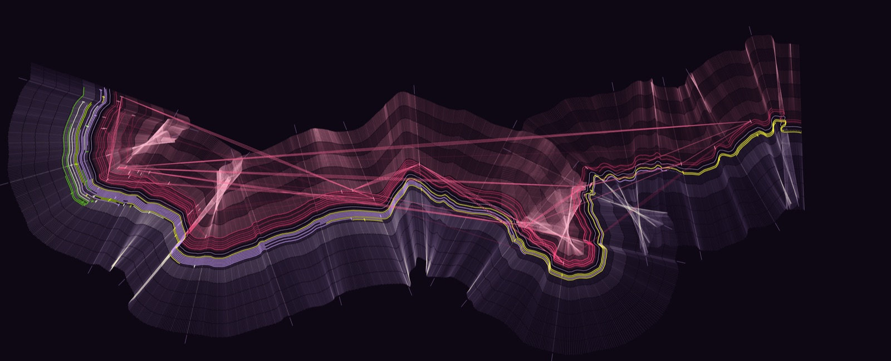

# Seed study E: Hachure



The River Avon in true plan, north up. Time runs down it. Every year is one straight stroke laid across the water, every day is one mark on that stroke, and the links the models proposed go the straight way over the land while time goes round by the river.

Run it with `node studies/seeds/e/render.mjs` (optionally `none`, `keywords` or `shuffled`, then a seed). It is deterministic: two runs give a byte-identical `out.png`.

## The string

```
QlWxZp5Mnqz9rfxFeZBtlkRI5DQFQKjtrNq6ZXIR3425TuHl7Sm1nPU4iYeYlsWJ0zuhHf7biI3jVIuHpKJKe0Lbas6TqLm6OpvwArZ2KhFtE6f93Ji4dqcNvycBUSRB
```

Made with this, before reading anything about the project, and kept as it came (`seed.txt`):

```
LC_ALL=C tr -dc 'A-Za-z0-9' < /dev/urandom | head -c 128 | tee seed.txt
```

## What I noticed, and what each thing became

| In the string | Decision |
|---|---|
| **Five characters never appear: `C G g o 8`.** Every one of them is a round letterform. | No curves anywhere. The picture is built only from straight strokes: no circles, no dots for knots, no smoothed lines. The river is drawn vertex to vertex as OpenStreetMap gives it. A record's focal year is a short bar, not a knot. This is what pushed the piece towards hachure, the short straight strokes old maps use to show a valley. |
| **Four small mirrors: `fxF`, `QFQ`, `YeY`, `KJK`.** A letter, something between, the same letter again. | The river is a mirror line. The records lie on one bank, and what the models made of them lies on the other, as a reflection. |
| **`hH` and `iI`,** five characters apart: a small letter followed at once by its own capital. | The reflection is the same thing, larger. A reflected thread sits 1.4 times further from the water than its record (roughly capital height over small-letter height). |
| **`3425` is the only place digits run together** (every other digit stands alone, apart from `93`). | It is the one colour that belongs to nothing else: hue 342.5°, a rose, used only for the models' layer. |
| **Digits by quarter of the string: `595`, `63425714`, `073066`, `26934`.** | Read as hues: 59.5° (straw), 73° (lime), 269° (violet). The digits sum to 97, a prime, read as 97° (leaf green). So the string wanted three close yellow-greens against a violet, with the rose set apart. The ground is violet; the strands take the rest. |
| **`073`, and 365 = 5 × 73.** | The scale of a day. A year's stroke is 730 px long, 2 px a day. |
| **It opens `QlWxZp`: capital, small, capital, small, capital, small,** then loses the pattern. | Months alternate strong and weak along every stroke, using the case of the first twelve characters. This makes the banding that runs parallel to the river. |
| **Capitals 52, small letters 54, digits 22.** Two nearly equal halves and a minority. | Two banks given equal room, and a smaller amount of accent colour. |
| **I wanted 34:25 as the page shape (from `3425`).** | Dropped. The river reach is nearly four times wider than tall and would not sit in it. The page is as wide as allowed and as tall as the river needs: 4000 × 1627. |

Things I noticed and did not use: `uH`/`uh` three times at gaps of 21 and 12; 22 digits matching the 22 `R` records; the two longest runs of capitals both being five long, like the five strands.

## Data to form

- **The river** is `data/river/avon-course.json`, all 14.8 km of it, projected flat with north up. Upstream (east) is at the right.
- **Time** is distance along the water: the year 230 (the earliest year any span names) at the upstream end, 13 October 2026 at the downstream end. About 2.7 px, or 8.2 m of river, to a year.
- **A year** is one straight stroke across the river, at right angles to the river's general direction there (taken over 760 m either side, so small wiggles do not flip it). 1 January is at the north tip, midsummer is at the water, 31 December is at the south tip.
- **A day** is one mark on the stroke: 656,262 of them. The first of each month is left dark, so months are parted by a thin contour. Decade years are a little brighter, century years much brighter, and each century stroke carries on past the fringe as a short rule. No lettering.
- **South bank, violet to straw: the documented side.** A day here is brighter the more records describe its year. Each record is a thread running along the bank for the span of years it describes (`data/described-spans.json`), in its strand's colour: river violet, settlement straw yellow, textiles lime, rubber leaf green, people near-white. A vague beginning or end is broken into dashes. A short bar crosses the thread at the focal year from experiment 01. Threads are packed into lanes nearest the water first, so a lane has no meaning beyond keeping threads apart.
- **North bank, rose: the models' side.** Only a record that the reading links to something has a reflection here. Its width and strength follow the total strength of its links. A day here is brighter the more link strength rests on its year.
- **Chords** are the links, drawn straight from one reflection's focal bar to the other's, one hairline per point of strength. Bright if other links back it up (study 03's rule: 16 of the 50), faint if not.
- **The pale veils** are not drawn on purpose. On the inside of a bend, year strokes converge and cross, and the days pile up. They mark where the river turns hard, and nothing else.

## What works and what doesn't

Works:

- As an image it has presence: it reads as a lit valley or a folded cloth without imitating either, and the river's own shape supplies the drama.
- It is a map. Someone who knows this reach of the Avon should recognise the bends, which the straightened strips of studies 04 and 05 could not offer.
- Detail holds at full size: individual days, month contours, century rules, separate threads. It is not a gradient.
- The removal test is visible at a glance. With reading `none` the north bank goes dim and bare and every chord disappears.
- The long early silence shows. Most of the river carries a handful of threads; the last two kilometres carry up to nineteen lanes.

Doesn't:

- **The chords are the weakest part.** Most links join the crowded 1800s to something older, so they fan out from one corner like a diagram, and the long horizontals fight the river's shape.
- **Shuffled still looks plausible.** It loses the bright chords (none of its links back each other up at seed 7) but keeps a rosy bank, so it is duller, not obviously wrong.
- **The veils are the most striking marks and carry no data** about the town's history, only about the river's curvature. The same criticism study 01's crescents earned.
- **Threads tangle at the tightest hairpin,** where the bank folds over itself. Honest geometry, but hard to read there.
- **Where a record sits along the river is its date, not its location.** The Kingston Mill threads lie at the downstream end of this map only because the 1800s fall there. A sense of place for the river, then, not for the records.
- **A day is a mark but carries nothing of its own,** only its year's and its month's brightness. The scale is felt as texture more than counted.
- **The 1800s are cramped.** Linear time gives the busiest two centuries 600 px of river.
- Which bank is which, the lane order, the 760 m smoothing, the brightness curves and every lightness and saturation are my choices, not the string's or the data's. The spans are Claude's unverified reading, as noted in study 05.
- River course © OpenStreetMap contributors, ODbL.
